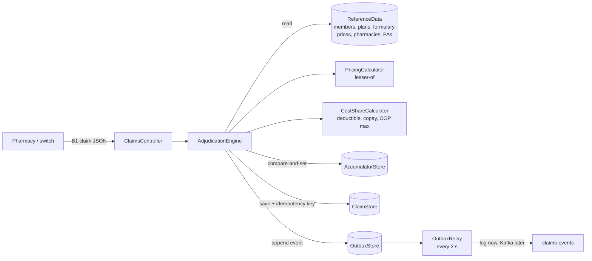

# Architecture notes

## Design choices to talk about

| Choice | Why | Production version |
| --- | --- | --- |
| Engine in plain Java | Business rules readable and unit-testable without Spring | Same; rules move to a versioned decision engine |
| Idempotency key | Switches retry on timeouts; never pay twice | UNIQUE index on the key for PAID claims |
| Per-member lock + optimistic locking | Two claims for one member mustn't both spend the deductible | `UPDATE ... WHERE version = ?` and retry |
| Transactional outbox | Saving the claim and publishing an event separately can lose events | Outbox table in the same DB transaction; relay to Kafka |
| Decision trace | Auditors and clients ask why a claim priced the way it did | Stored with the claim; rule and price-list versions included |
| Rejected claims don't hold the key | Pharmacy must be able to resubmit after fixing the issue (e.g. PA approved) | Same |
